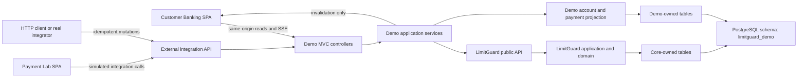

# LimitGuard Customer Banking Demo

`demo-service` is an independently runnable Spring Boot consumer of `limitguard-core`. It
serves a fictional household scenario and two deliberately separate Angular applications
from one JAR:

- Customer Banking at `/limitguard/demo` for accounts, activity, cards, and limit settings.
- Payment Lab at `/limitguard/payments` for exercising an external payment lifecycle.



The dependency rule is `controller -> demo application service -> LimitGuard public API`.
Only `DemoConfiguration`, the composition root, imports `JooqLimitguardFactory`. Controllers
never use core repositories, domain objects, jOOQ records, or SQL details.

## Scenario

The fixed persona is Emma Clarke. She owns personal savings and has delegated access to a
household current account owned by Daniel Clarke. One display-safe fictional debit card is
linked to the household account.

The bootstrap creates card-purchase, ATM-withdrawal, and bank-transfer catalogs plus these EUR
limits:

| Operation | Limit | Self-service cap |
| --- | ---: | ---: |
| Card purchases | 1,500 daily | 3,000 |
| ATM withdrawals | 500 daily | 1,000 |
| Transfers | 2,500 per transaction | 5,000 |
| Transfers | 5,000 daily | 10,000 |

Emma changes these limits on Daniel's account as his authorized user. Five tenant policies
judge each change in priority order, and the first that matches decides. The middle three are
bound to one configuration each, after rules real banks apply to proxies, agreed maximum
limits, and raised card limits:

| Priority | Policy | Applies to | Decision |
| ---: | --- | --- | --- |
| 10 | `DENY_BELOW_CURRENT_EXPOSURE` | every limit | Deny an amount below what is already spent or held |
| 20 | `PROXY_MAY_ONLY_LOWER` | ATM withdrawals | Deny a raise asked by anyone but the account holder |
| 30 | `ABOVE_AGREED_MAXIMUM` | daily transfers | Hold an amount above the agreed 7,500 for the holder's approval |
| 40 | `CARD_RAISE_COOLING_OFF` | card purchases | Allow a raise, but start it when the cooling-off period ends |
| 100 | `ALLOW_DEMO_SELF_SERVICE` | every limit | Allow the rest |

The demo sends `currentExposure` and `coolingOffEndsAt` as policy facts.
JSON Logic has no date arithmetic, so the demo computes the cooling-off end itself from
`limitguard.demo.cooling-off` (2 minutes; KBC uses four hours), and the policy's
`SET_EFFECTIVE_AT` action moves the change's start to it. LimitGuard runs no jobs, so the demo
calls `applyDueLimitChanges` every `limitguard.demo.due-pass-interval` (15 seconds) to apply
changes whose time has come.

A held or scheduled change shows on the Limits page, where Emma can withdraw it. Payment Lab
plays Daniel's banking app and approves or rejects held changes through the integration API.

On first start the demo also sends seven payments through its own integration path: five
settled card, ATM, and transfer payments, one card hold, and one card purchase declined for
exceeding the daily card limit. They count against today's limits like any other payment, and
a restart replays them by their idempotency keys instead of paying twice.

Balances are projections: booked balance is opening balance minus captured amounts; available
balance additionally subtracts uncaptured holds. The customer application cannot create or
mutate payments. Payment mutations come through the external integration API, either from an
HTTP client or from the separate local-only Payment Lab. Each completed mutation emits an SSE
invalidation so Customer Banking refetches authoritative state.

## Run

From the repository root, with Java 25 and Docker available:

```bash
docker compose up -d --wait postgres
cd services/demo-service
SERVER_ADDRESS=127.0.0.1 ./gradlew bootRun
```

Open [Customer Banking](http://localhost:8081/limitguard/demo) and
[Payment Lab](http://localhost:8081/limitguard/payments) in separate tabs. Authorize a payment
in Payment Lab and keep Customer Banking on Activity to see it appear without reloading.
Authorization reserves limit capacity, capture consumes it, release restores a hold, and
reversal restores captured capacity. `./gradlew bootJar` builds one runnable JAR with both
Angular applications and all migrations inside.

The demo uses the `limitguard_demo` schema of the local `limitguard` database. Core
migrations run first, then the demo's own. `LIMITGUARD_DEMO_DB_URL`, `POSTGRES_USER`,
`POSTGRES_PASSWORD`, and `LIMITGUARD_DEMO_PORT` override the defaults. To return to the
seeded scenario, stop the demo, drop the schema, and start it again:

```bash
docker compose exec -T postgres psql -U limitguard -d limitguard -c \
  'DROP SCHEMA IF EXISTS limitguard_demo CASCADE;'
```

`./gradlew test` builds and tests both Angular applications and runs the backend tests,
including a journey against a PostgreSQL Testcontainer. With the demo running,
`cd ui && npm run e2e` runs the Playwright suite. `http/demo-payments.http` holds a request
journey for the JetBrains HTTP client.

## Curl Journey

The examples below use `jq` to read the server-generated public IDs.

```bash
BASE=http://localhost:8081/limitguard/demo/api/v1
SCENARIO=$(curl -fsS "$BASE/scenario")
ACCOUNT_ID=$(printf '%s' "$SCENARIO" | jq -r '.accountIds[0]')
CARD_ID=$(printf '%s' "$SCENARIO" | jq -r '.cardIds[0]')
```

Authorize and capture a card purchase, then reverse the captured amount:

```bash
curl -sS -X POST "$BASE/integrations/payment-authorizations" \
  -H 'Content-Type: application/json' -H 'Idempotency-Key: curl-card-auth-001' \
  -d "{\"externalPaymentId\":\"curl-card-001\",\"operation\":\"CARD_PURCHASE\",\"accountId\":\"$ACCOUNT_ID\",\"cardId\":\"$CARD_ID\",\"amount\":\"85.40\",\"currency\":\"EUR\",\"description\":\"Corner Grocer\",\"category\":\"GROCERIES\"}"

curl -sS -X POST "$BASE/integrations/payments/curl-card-001/captures" \
  -H 'Content-Type: application/json' -H 'Idempotency-Key: curl-card-capture-001' \
  -d '{"amount":"85.40","reason":"Clearing completed"}'

curl -sS -X POST "$BASE/integrations/payments/curl-card-001/reversals" \
  -H 'Content-Type: application/json' -H 'Idempotency-Key: curl-card-reversal-001' \
  -d '{"amount":"85.40","reason":"Merchant refund"}'
```

Reserve 400 EUR at an ATM, observe a cumulative denial for another 150 EUR, then release the
first authorization:

```bash
curl -sS -X POST "$BASE/integrations/payment-authorizations" \
  -H 'Content-Type: application/json' -H 'Idempotency-Key: curl-atm-auth-001' \
  -d "{\"externalPaymentId\":\"curl-atm-001\",\"operation\":\"ATM_WITHDRAWAL\",\"accountId\":\"$ACCOUNT_ID\",\"cardId\":\"$CARD_ID\",\"amount\":\"400.00\",\"currency\":\"EUR\",\"description\":\"ATM authorization\",\"category\":\"CASH\"}"

curl -sS -X POST "$BASE/integrations/payment-authorizations" \
  -H 'Content-Type: application/json' -H 'Idempotency-Key: curl-atm-denial-001' \
  -d "{\"externalPaymentId\":\"curl-atm-denied-001\",\"operation\":\"ATM_WITHDRAWAL\",\"accountId\":\"$ACCOUNT_ID\",\"cardId\":\"$CARD_ID\",\"amount\":\"150.00\",\"currency\":\"EUR\",\"description\":\"ATM cumulative denial\",\"category\":\"CASH\"}"

curl -sS -X POST "$BASE/integrations/payments/curl-atm-001/releases" \
  -H 'Content-Type: application/json' -H 'Idempotency-Key: curl-atm-release-001' \
  -d '{"amount":"400.00","reason":"Cash not dispensed"}'
```

Exercise transfer denial and a successful transfer lifecycle:

```bash
curl -sS -X POST "$BASE/integrations/payment-authorizations" \
  -H 'Content-Type: application/json' -H 'Idempotency-Key: curl-transfer-denial-001' \
  -d "{\"externalPaymentId\":\"curl-transfer-denied-001\",\"operation\":\"BANK_TRANSFER\",\"accountId\":\"$ACCOUNT_ID\",\"amount\":\"2600.00\",\"currency\":\"EUR\",\"description\":\"Transfer above per-transaction cap\",\"category\":\"TRANSFER\"}"

curl -sS -X POST "$BASE/integrations/payment-authorizations" \
  -H 'Content-Type: application/json' -H 'Idempotency-Key: curl-transfer-auth-001' \
  -d "{\"externalPaymentId\":\"curl-transfer-001\",\"operation\":\"BANK_TRANSFER\",\"accountId\":\"$ACCOUNT_ID\",\"amount\":\"800.00\",\"currency\":\"EUR\",\"description\":\"Household transfer\",\"category\":\"TRANSFER\"}"

curl -sS -X POST "$BASE/integrations/payments/curl-transfer-001/captures" \
  -H 'Content-Type: application/json' -H 'Idempotency-Key: curl-transfer-capture-001' \
  -d '{"amount":"800.00","reason":"Transfer settled"}'
```

Identical retries return the stored result with `replayed=true`. Reusing a key with another
payload returns `409`.

Ask for a daily transfer limit above the agreed maximum, then approve it as the account
holder:

```bash
DAILY_ID=$(curl -fsS "$BASE/customer/limits" | jq -r '.[] | select(.limitKind == "PERIODIC" and .operation == "BANK_TRANSFER") | .id')
CHANGE_ID=$(curl -fsS -X PATCH "$BASE/customer/limits/$DAILY_ID" \
  -H 'Content-Type: application/json' -H 'Idempotency-Key: curl-daily-limit-001' \
  -d '{"amount":"9000.00"}' | jq -r '.limit.pendingChange.id')

curl -sS -X POST "$BASE/integrations/limit-changes/$CHANGE_ID/approval"
```

`POST .../rejection` with `{"reason":"..."}` rejects it instead, and
`DELETE $BASE/customer/limits/$DAILY_ID/pending-change` withdraws it.

## Scope

This is a local portfolio demo: it intentionally has no login, customer isolation, API key,
insufficient-funds engine, settlement engine, incoming payments, Kafka, Redis, or production
deployment. Payment Lab is a development-only integration simulator, not a customer payment
feature or production merchant terminal. LimitGuard Admin remains a separate control-plane
application and does not own the demo schema.
